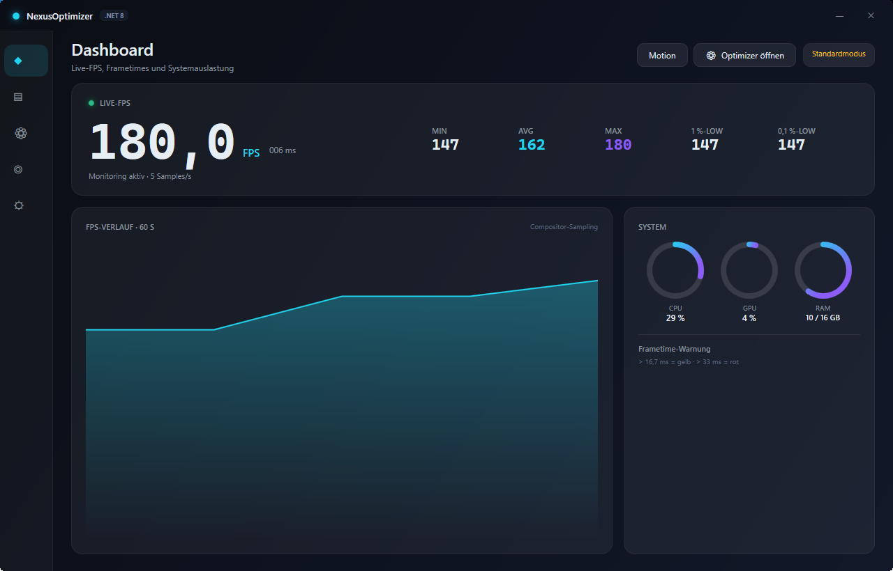

# NexusOptimizer (.NET 8 · WPF · MVVM)

Gaming-Optimizer mit Live-FPS-Monitor – Neuaufbau auf dem geforderten Stack.
**Stand: Stufe 1 von 10 abgeschlossen und lauffähig.**



## Fertig (Stufe 1)

| Bereich | Umsetzung |
|---|---|
| Stack | C# 12, WPF, `net8.0-windows`, self-contained Single-File-Publish |
| Architektur | MVVM via `CommunityToolkit.Mvvm` (Source Generators), DI via `Microsoft.Extensions.DependencyInjection` |
| Datenbank | SQLite (`Microsoft.Data.Sqlite`) mit Schema `Settings`, `Sessions`, `FpsSamples`, `Optimizations` |
| Logging | Serilog → `%LOCALAPPDATA%\NexusOptimizer\logs`, globaler `DispatcherUnhandledException`-Handler |
| FPS | `FpsSampler` misst echte Compositor-Frames über `CompositionTarget.Rendering` (kein Fake, kein Schätzen aus Hz) |
| Diagnose | Min/Avg/Max, 1 %- und 0,1 %-Lows aus echten Frametimes, Frametime in ms |
| System | CPU (PerformanceCounter), GPU (`GPU Engine`-Counter, 3D-Engine-Summe), RAM – Sampling im Hintergrundthread |
| UI | Dark-Glassmorphism-Shell, eigene Titelleiste (`WindowChrome`), **Fenster/Vollbild umschaltbar** (Buttons □/⛶, F11, Esc), aufklappbare Sidebar mit Beschriftungen, Karten mit Hover, Live-Chart mit Flächengradient, animierter Status-Dot |
| Optimizer | 8 echte Tweaks als Karten mit Risiko-Badge (Niedrig/Mittel), Toggle-Switch, Statuszeile, „Alles optimieren“/„Alles zurücksetzen“; jede Änderung wird mit Vorher-Wert in `Optimizations` protokolliert |
| Publish | eine `NexusOptimizer.exe` (64,6 MB, komprimiert, self-contained) |

## Animationssystem (Motion)

| Datei | Inhalt |
|---|---|
| `Themes/Motion.xaml` | Tokens: Dauern (Instant 80 ms … Ambient 1800 ms), Easings (Standard/Emphasized/Overshoot/Exit), Offsets 8/16/24 px, Scales 1.015/0.985/0.92/1.06, Stagger 35 ms |
| `Themes/Animations.xaml` | deklarative Storyboards (FadeIn, PopIn, Shake, LiveDot) |
| `Services/MotionService.cs` | API `FadeIn/SlideIn/PopIn/StaggerIn/CountUp/Pulse/Shake/Ripple/CrossFade`, Level (Aus/Wenig/Voll), SpeedFactor, RDP-Erkennung, `SystemParameters.ClientAreaAnimation` |
| `Behaviors/Animations.cs` | `b:Animations.Entry="Pop|Fade|Slide|Stagger"`, `EntryIndex`, `Hover="Card"`, `Press="True"` |
| `Controls/MotionControls.cs` | `AnimatedNumber` (Tabular-Ziffern, Count-Up), `AnimatedRing` (Arc + Gradient), `Sparkline`, `CrossFadeHost`, `RippleButton` (Adorner-Ripple), `ToastHost` |
| `Views/MotionPlaygroundWindow` | jede Animation per Button, Motion-Level + Speed live umschaltbar (Button **Motion** im Header) |

**Barrierefreiheit:** `MotionService.Enabled` respektiert Systemeinstellungen und RDP; „Aus/Wenig/Voll“ schaltet global; alle Animationen nutzen `FillBehavior.Stop`, Basiswert ist immer der Endzustand → nichts bleibt „kleben“; `HandoffBehavior.SnapshotAndReplace` macht jede Animation unterbrechbar.

**In der App verdrahtet:** Fensterstart (Fade + Scale 0.98→1 + 16 px Slide, 200 ms Emphasized), Seitenwechsel per `CrossFadeHost` (alt 140 ms raus, neu 200 ms rein mit 20 px Slide), Karten-Stagger beim Einstieg, Hover (Scale 1.015, Y −2, Cyan-Glow) und Press (0.985) auf Hero-, Chart-, System- und Optimizer-Karten, Count-Up für FPS/MIN/AVG/MAX/Lows, Ring-Charts für CPU/GPU/RAM statt Balken, pulsierender Live-Dot (2 s), Toasts und Ripple im Playground.

**Bekannte Lücken dieser Stufe:** Chart-Linien-Zeichnung per `StrokeDashOffset`, Partikel, Gradient-Drift und die Sidebar-Expansion (animiert weiterhin die Breite) sind noch nicht umgestellt.

## Bauen & Veröffentlichen

```powershell
# SDK (falls nicht vorhanden)
Invoke-WebRequest https://dot.net/v1/dotnet-install.ps1 -OutFile dotnet-install.ps1
./dotnet-install.ps1 -Channel 8.0 -InstallDir "$env:LOCALAPPDATA\Microsoft\dotnet"

cd NexusOptimizer
dotnet publish src/NexusOptimizer/NexusOptimizer.csproj -c Release -r win-x64 `
  --self-contained true -p:PublishSingleFile=true `
  -p:IncludeNativeLibrariesForSelfExtract=true -p:EnableCompressionInSingleFile=true `
  -o publish
```

Ergebnis: `NexusOptimizer/publish/NexusOptimizer.exe` – keine .NET-Installation nötig.

## Bekannte Einschränkungen (ehrlich)

- **FPS ist Compositor-Sampling**, noch kein ETW (`Microsoft-Windows-DXGI`) und kein PresentMon –
  damit werden aktuell Display-Frames gemessen, nicht die Present-Events eines Spiels. Stufe 4.
- **Overlay**, **Statistik-Seite** und **Einstellungen** sind noch Platzhalter
  (Empty-State-Karten), LiveCharts2 und LibreHardwareMonitorLib sind noch nicht eingebunden.
- Der Optimizer ist funktionsfähig: HKCU-Tweaks (Game Bar, Visuelle Effekte) wirken sofort,
  System-Tweaks (Energieplan, HAGS, DiagTrack, Xbox-Dienste, TCP) sind ohne Adminrechte
  deaktiviert und werden im Banner als solche gekennzeichnet.
- **Kein `requireAdministrator`** im Manifest: die App startet bewusst ohne UAC-Zwang im
  eingeschränkten Modus (Banner „Standardmodus“); Admin-Tweaks folgen in Stufe 7.
- **Single-File-Extraktion:** Auf diesem Testsystem verweigert der Host das Anlegen von
  `%TEMP%\.net` (Fehler 5) – Start dann mit gesetztem
  `DOTNET_BUNDLE_EXTRACT_BASE_DIR` (z. B. `%LOCALAPPDATA%\NexusOptimizer\bundle`) oder mit der
  Ordner-Variante (`-p:PublishSingleFile=false`). Auf normalen Systemen startet die EXE direkt.

## Nächste Stufen

2) Theme/Controls (GlassCard, RingChart, ToggleSwitch, Hover-/Disabled-Zustände) ·
3) Services & DB-Repository · 4) ETW/DXGI-FPS mit Channel-Batching · 5) Dashboard + LiveCharts2 ·
6) In-Game-Overlay (click-through, Hotkey, Persistenz) · 7) Optimizer + Restore-Points ·
8) Statistik/Settings · 9) Tests · 10) Publish-Verifikation
