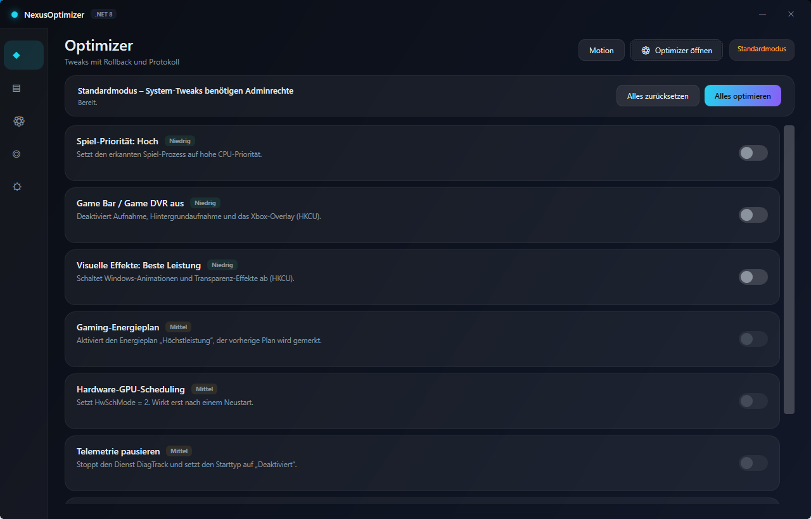
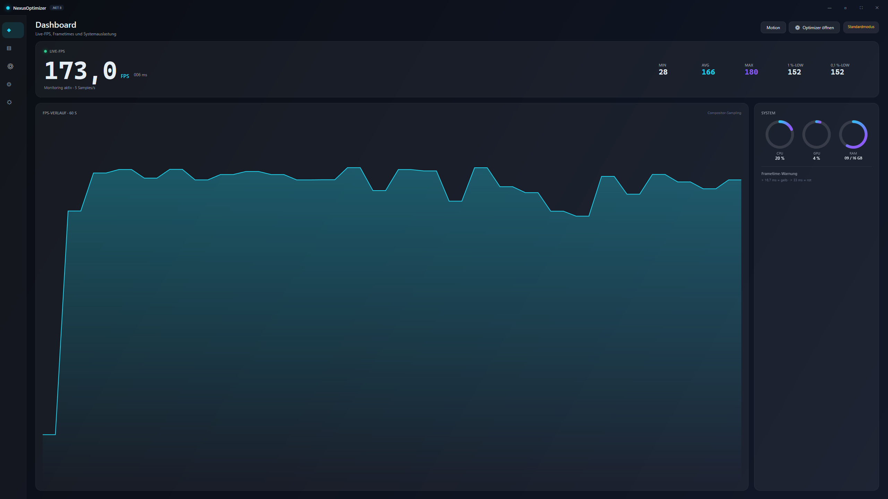

# NexusOptimizer

A Windows gaming optimizer with live FPS monitoring, real system telemetry and reversible tweaks.
Built with **C# 12 / WPF on .NET 8**, a dark glassmorphism UI, a custom motion system and a single-file executable.

> The UI is intentionally **German** (target audience) – this documentation is English.


## Features

| Area | What it does |
|---|---|
| **Live FPS** | Frame sampling via `CompositionTarget.Rendering`, MIN / AVG / MAX, 1 %- and 0.1 %-lows computed from real frame times |
| **Charts** | 60 s FPS history with gradient fill, frame-time graph, session bars |
| **System panel** | CPU (`PerformanceCounter`), GPU (`GPU Engine` 3D counters), RAM – sampled on a background thread, rendered as animated rings |
| **Optimizer** | 8 real tweaks (process priority, Game DVR/Game Bar, visual effects, power plan, HAGS, telemetry, Xbox services, TCP tuning) with risk badges, toggles, “apply all” / “reset all”, and per-change logging (incl. previous value) into SQLite |
| **Sessions** | SQLite schema for `Sessions`, `FpsSamples`, `Optimizations`, `Settings`; WAL mode |
| **Motion system** | Central tokens (`Themes/Motion.xaml`), `MotionService`, attached behaviors (`Entry`, `Hover`, `Press`), controls (`AnimatedNumber`, `AnimatedRing`, `Sparkline`, `CrossFadeHost`, `RippleButton`, `ToastHost`) and a live playground (button **Motion**) |
| **Window modes** | Custom chrome, maximize/restore, borderless fullscreen (F11 / Esc), sidebar that expands on hover |
| **Robustness** | No UAC prompt (`asInvoker`), single-instance guard, Serilog logging, global exception handling |




## Tech stack

- .NET 8 (`net8.0-windows`), WPF, C# 12
- MVVM via `CommunityToolkit.Mvvm` source generators, DI via `Microsoft.Extensions.DependencyInjection`
- SQLite via `Microsoft.Data.Sqlite`, logging via `Serilog`
- Publish: self-contained, single-file, compressed

## Build

```powershell
dotnet restore src/NexusOptimizer/NexusOptimizer.csproj
dotnet build src/NexusOptimizer/NexusOptimizer.csproj -c Release

dotnet publish src/NexusOptimizer/NexusOptimizer.csproj -c Release -r win-x64 `
  --self-contained true -p:PublishSingleFile=true `
  -p:IncludeNativeLibrariesForSelfExtract=true -p:EnableCompressionInSingleFile=true `
  -o publish
```

Result: `publish/NexusOptimizer.exe` – one file, no .NET installation required.

### Folder build (recommended if single-file extraction is blocked)

```powershell
dotnet publish src/NexusOptimizer/NexusOptimizer.csproj -c Release -r win-x64 `
  --self-contained true -p:PublishSingleFile=false -o app
```

If the single-file host fails with *“Failed to create default extraction directory … error code: 5”*,
the temp folder is locked down. Use the folder build, or set `DOTNET_BUNDLE_EXTRACT_BASE_DIR`
to a writable directory before starting the exe.

## Project layout

```
src/NexusOptimizer/
├─ Services/      FpsSampler, SystemMonitor, Database, OptimizerService, MotionService
├─ ViewModels/    Main, Dashboard, Optimizer
├─ Views/         DashboardView, OptimizerView, MotionPlaygroundWindow
├─ Controls/      AnimatedNumber, AnimatedRing, Sparkline, CrossFadeHost, RippleButton, ToastHost
├─ Behaviors/     Animations (Entry / Hover / Press attached properties)
├─ Themes/        Colors, Styles, Motion tokens, Storyboards
└─ Assets/        app.ico, app.png
tools/gen_brand.py   generates logo, .ico and promo image (Pillow)
ci/build.yml         GitHub Actions workflow (requires the `workflow` token scope to be pushed)
```

## Known limitations

- FPS is measured from the **WPF compositor**, not from per-game Present events yet
  (ETW / `Microsoft-Windows-DXGI` with PresentMon fallback is planned).
- Statistics page, settings page and the in-game overlay are still placeholders.
- Some optimizer tweaks require administrator rights; without elevation they are visibly
  disabled, and the app never crashes on access violations.
- The sidebar expansion still animates layout width (all other motion uses
  `RenderTransform` / `Opacity`).

## License

MIT – see [LICENSE](LICENSE). Use the tuning features at your own risk.
