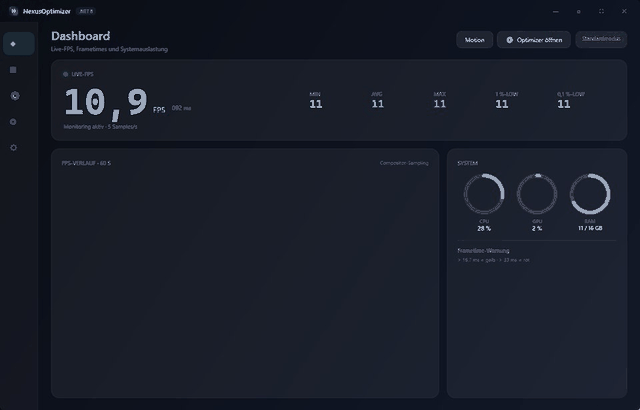
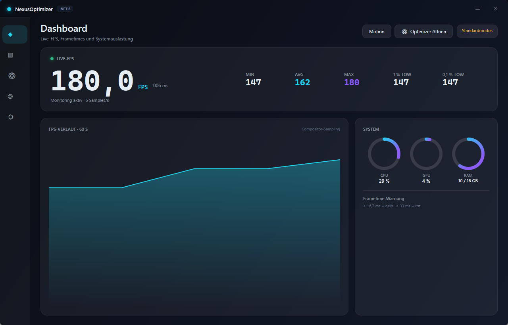
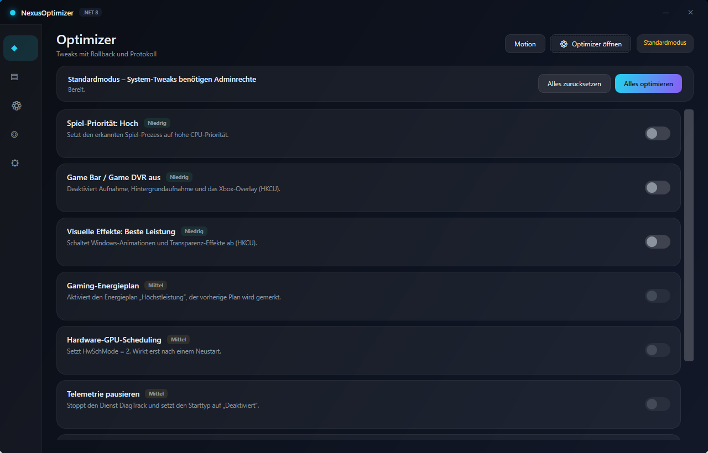
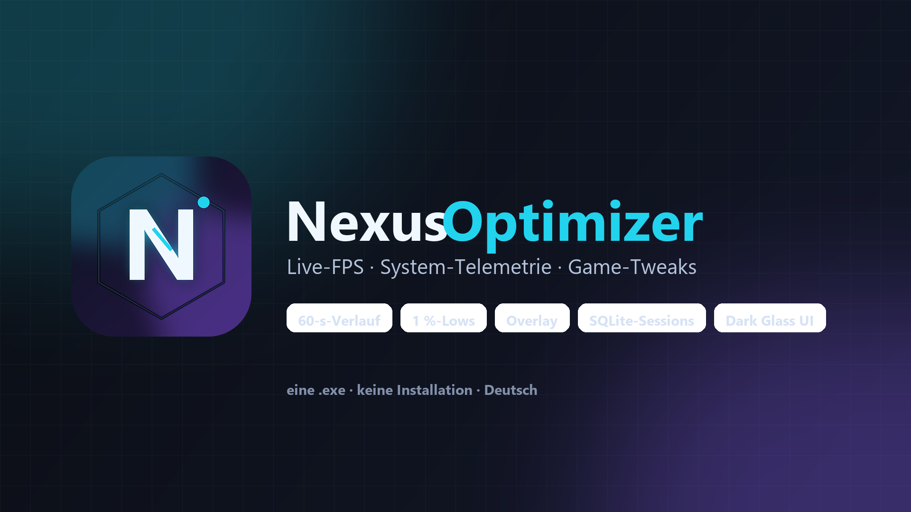

# NexusOptimizer v1.1.0

## Neu in dieser Version

- Autostart mit Sichern und Wiederherstellen
- Backups und Cleaner mit Vorschau und Bestätigung
- Prozessmanager mit Suche, Sortierung, Merkliste und Verlauf
- Monitorsteuerung mit verfügbaren Modi, Helligkeit und Profilen, soweit vom Display unterstützt
- Statistik, Einstellungen und klickdurchlässiges Overlay
- Überarbeitete RAM-Freigabe und flüssigere Navigation/Animationen

## Download

**Windows 10/11 · x64:** `NexusOptimizer-win-x64.zip` herunterladen, entpacken und `NexusOptimizer.exe` starten. Das Paket ist selbstenthaltend; .NET muss nicht separat installiert werden.

## Screenshots

## Lizenz und Hinweise

MIT-Lizenz: [LICENSE](https://github.com/uzunsaid8161-design/NexusOptimizer/blob/main/LICENSE).

SmartScreen kann bei einer neuen, nicht öffentlich signierten Version warnen. Die FPS-Anzeige misst die NexusOptimizer-Oberfläche, nicht direkt ein Spiel. Displayfunktionen hängen vom Monitor und Treiber ab; RAM-Freigabe kann keine feste Menge garantieren.
